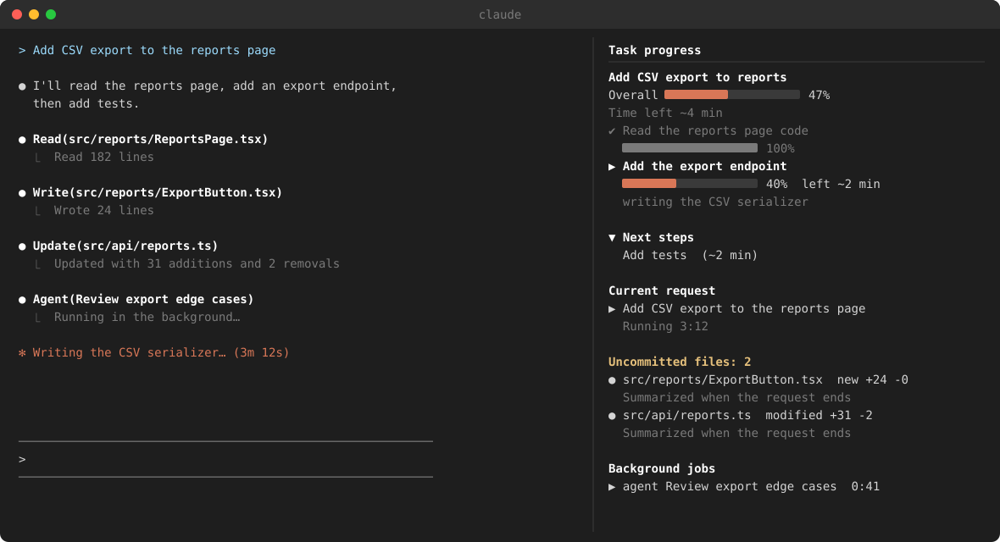
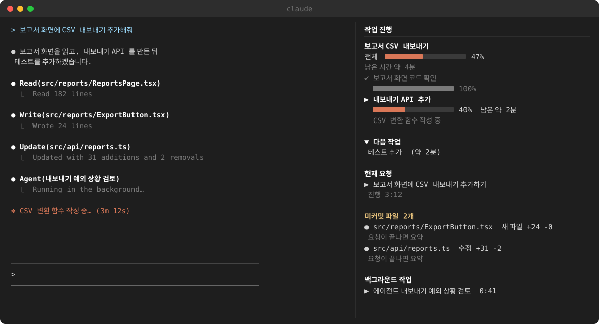

# right-panel-mods

[English](#english) | [한국어](#한국어)

## English

A marketplace of right-side pane mods for Claude Code.

| No. | Mod | What it does |
|---|---|---|
| 1 | task-progress | Shows progress, time left, and next steps of the current task in a pane on the right |



The picture is an illustration drawn from sample data. The pane uses the same section order and wording as the mod.

### Install

Run this in the Claude Code prompt.

```
/plugin install task-progress --marketplace binaryarc/right-panel-mods
```

- When asked to add the marketplace, answer `y` and choose the `user` scope.
- If the pane does not appear, type `/progress`. It does not open automatically when the terminal is narrower than about 110 columns.

### Update

```
claude plugin marketplace update right-panel-mods
claude plugin update task-progress@right-panel-mods
```

In sessions that are already open, type `/reload-plugins`.

### Language

The pane, the instructions the mod sends to Claude, and the haiku summaries follow one language: English or Korean.

| No. | Value of the `language` option | Language used |
|---|---|---|
| 1 | `auto` (default) | Picked automatically (order below) |
| 2 | `en` | English |
| 3 | `ko` | Korean |

With `auto` the mod checks these in order and uses the first one that is set.

1. Claude Code's `language` setting (for example `"language": "english"` in `~/.claude/settings.json`)
2. The `LC_ALL`, `LC_MESSAGES` or `LANG` environment variable
3. The Windows region (`Get-Culture`), read once and cached in `~/.claude/task-progress/.culture`
4. English

Change the option in `/config`, or in `~/.claude/settings.json`:

```json
{
  "pluginConfigs": {
    "task-progress@right-panel-mods": {
      "options": { "language": "en" }
    }
  }
}
```

### How task-progress works

- The current request, subagents, and background commands are shown automatically.
- The current request is shown as a one-line summary written by the haiku model. If summarizing fails, the first line of the original message is shown. Each request adds one haiku call to your usage.
- Bash and PowerShell commands that failed during the current request appear under "Failed commands". Repeated failures of the same command are grouped into one line with a count, and only the latest 5 are kept. Commands run by subagents or in the background are not included.
- Files changed in this session with Write, Edit, or NotebookEdit that are not committed yet appear under "Uncommitted files". Each line shows the git status and added/removed line counts, followed by a one-line summary that haiku writes from the diff. Summaries are made after the request ends, only for files whose diff changed, adding one haiku call per file to your usage. Committed files drop off the list within 10 seconds. Files changed by shell commands are not included, and git must be on PATH or in `%ProgramFiles%\Git\cmd`.
- Per-step progress appears only when Claude writes `~/.claude/task-progress/{sessionId}.json`. The mod tells Claude how to write it with every message, so no extra setup is needed.
- Session files older than 7 days and files of sessions ended with `/clear` are deleted automatically. Deletion works on Windows only.

### Example progress file

This is the kind of file Claude writes. It produces the pane in the picture above.

```json
{
  "title": "Add CSV export to reports",
  "tasks": [
    { "name": "Read the reports page code", "status": "done" },
    { "name": "Add the export endpoint", "status": "running", "percent": 40, "etaSec": 120, "note": "writing the CSV serializer" },
    { "name": "Add tests", "status": "next", "etaSec": 120 }
  ]
}
```

| No. | Field | Meaning |
|---|---|---|
| 1 | `status` | `done`, `running` or `next` |
| 2 | `percent` | 0 to 100. Claude updates it while a step runs |
| 3 | `etaSec` | Seconds the step is expected to take. For a running step, the seconds still left |
| 4 | `note` | One extra line shown under the step |

### How time left is calculated

- The mod records when it first sees a step become `running`. It does not trust a `startedAt` that Claude writes, because those are often guessed.
- Each time Claude writes a new `percent` or `etaSec`, the mod makes one estimate and then counts it down. A stale `percent` no longer makes the time left grow.
- A `next` step's `etaSec` becomes the first estimate when that step starts running.
- When some steps have no estimate, the total adds up the known ones and shows `+` (for example `~4 min+`).
- When the estimate runs out before the step ends, the pane shows "almost done".
- A file written during the current request is always shown. A file left with a running step from an earlier request is hidden once it has not been written for 30 minutes, because the step was most likely abandoned.

### Development

```
claude plugin validate task-progress
claude plugin test task-progress
```

## 한국어

Claude Code 오른쪽 패널 모드 마켓플레이스입니다.

| No. | 모드 | 기능 |
|---|---|---|
| 1 | task-progress | 진행 중인 작업의 진행률, 남은 시간, 다음 작업을 오른쪽 창에 보여줍니다 |



예시 데이터로 그린 그림입니다. 창의 칸 순서와 문구는 모드와 같습니다.

### 설치

Claude Code 프롬프트에서 실행합니다.

```
/plugin install task-progress --marketplace binaryarc/right-panel-mods
```

- 마켓플레이스 추가를 물으면 `y`, 범위는 `user` 를 고릅니다.
- 창이 보이지 않으면 `/progress` 를 입력합니다. 터미널 폭이 약 110열보다 좁으면 자동으로 열리지 않습니다.

### 업데이트

```
claude plugin marketplace update right-panel-mods
claude plugin update task-progress@right-panel-mods
```

열려 있는 세션에서는 `/reload-plugins` 를 입력합니다.

### 언어

창 문구, 모드가 Claude 에게 보내는 안내문, haiku 요약이 한 언어(영어 또는 한국어)를 따릅니다.

| No. | `language` 옵션 값 | 쓰는 언어 |
|---|---|---|
| 1 | `auto` (기본값) | 자동으로 고름 (아래 순서) |
| 2 | `en` | 영어 |
| 3 | `ko` | 한국어 |

`auto` 이면 아래 순서로 확인해 처음 정해진 값을 씁니다.

1. Claude Code 의 `language` 설정 (예: `~/.claude/settings.json` 의 `"language": "korean"`)
2. 환경변수 `LC_ALL`, `LC_MESSAGES`, `LANG`
3. Windows 지역 설정(`Get-Culture`). 한 번 읽어 `~/.claude/task-progress/.culture` 에 저장해 둡니다
4. 영어

옵션은 `/config` 에서 바꾸거나 `~/.claude/settings.json` 에 적습니다.

```json
{
  "pluginConfigs": {
    "task-progress@right-panel-mods": {
      "options": { "language": "ko" }
    }
  }
}
```

### task-progress 동작

- 현재 요청, 서브에이전트, 백그라운드 명령을 자동으로 표시합니다.
- 현재 요청은 haiku 모델이 한 줄로 요약해 보여줍니다. 요약에 실패하면 원문 첫 줄을 보여줍니다. 요청마다 haiku 호출 1회가 사용량에 더해집니다.
- 이번 요청에서 실패한 Bash, PowerShell 명령을 「실패한 명령」 칸에 보여줍니다. 같은 명령은 한 줄로 묶어 횟수를 표시하고, 최근 5개만 남깁니다. 서브에이전트와 백그라운드 명령은 포함하지 않습니다.
- 이 세션에서 Write, Edit, NotebookEdit 로 고쳤고 아직 커밋하지 않은 파일을 「미커밋 파일」 칸에 보여줍니다. 파일명 옆에 git 상태와 추가, 삭제 줄 수를, 그 아래에 haiku 가 diff 를 읽고 적은 한 줄 요약을 보여줍니다. 요약은 요청이 끝난 뒤 내용이 바뀐 파일만 만들며, 파일마다 haiku 호출 1회가 사용량에 더해집니다. 커밋하면 10초 안에 목록에서 빠집니다. 셸 명령으로 고친 파일은 포함하지 않으며, git 이 PATH 나 `%ProgramFiles%\Git\cmd` 에 있어야 합니다.
- 단계별 진행률은 Claude 가 `~/.claude/task-progress/{세션ID}.json` 을 작성해야 보입니다. 작성 방법은 모드가 메시지마다 Claude 에게 안내하므로 따로 설정할 것이 없습니다.
- 7일이 지난 세션 파일과 `/clear` 로 끝난 세션 파일은 자동으로 삭제됩니다. 삭제는 Windows 에서만 동작합니다.

### 진행 파일 예시

Claude 가 적는 파일의 모양입니다. 위 그림의 창이 이 파일에서 나옵니다.

```json
{
  "title": "보고서 CSV 내보내기",
  "tasks": [
    { "name": "보고서 화면 코드 확인", "status": "done" },
    { "name": "내보내기 API 추가", "status": "running", "percent": 40, "etaSec": 120, "note": "CSV 변환 함수 작성 중" },
    { "name": "테스트 추가", "status": "next", "etaSec": 120 }
  ]
}
```

| No. | 필드 | 뜻 |
|---|---|---|
| 1 | `status` | `done`, `running`, `next` 중 하나 |
| 2 | `percent` | 0 ~ 100. 단계가 도는 동안 Claude 가 고쳐 씁니다 |
| 3 | `etaSec` | 그 단계에 걸릴 예상 초. running 단계는 남은 초 |
| 4 | `note` | 단계 아래에 보이는 한 줄 설명 |

### 남은 시간 계산 방식

- 단계가 `running` 이 된 것을 모드가 처음 본 시각을 시작 시각으로 기록합니다. Claude 가 적는 `startedAt` 은 어림한 값이 많아 그대로 쓰지 않습니다.
- Claude 가 새 `percent` 나 `etaSec` 를 적을 때마다 그 순간 예상을 한 번 잡고, 그 뒤로는 시간이 흐른 만큼 줄여 갑니다. `percent` 가 오래 안 바뀌어도 남은 시간이 불어나지 않습니다.
- `next` 단계에 적힌 `etaSec` 는 그 단계가 시작될 때 첫 예상으로 씁니다.
- 예상이 없는 단계가 있으면 아는 단계만 더하고 「이상」을 붙입니다 (예: `약 4분 이상`).
- 단계가 끝나기 전에 예상이 다 줄어들면 「곧 완료」로 보여줍니다.
- 지금 요청 중에 고쳐진 파일은 항상 보여줍니다. 이전 요청에서 running 단계를 닫지 않고 남긴 파일은 30분 넘게 고쳐지지 않으면 버려진 것으로 보고 숨깁니다.

### 개발

```
claude plugin validate task-progress
claude plugin test task-progress
```
